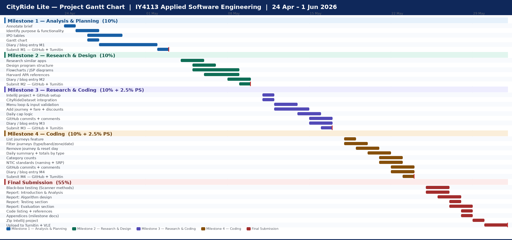

# IY4113 Milestone 1

| Assessment Details | Please Complete All Details                                             |
| ------------------ | ----------------------------------------------------------------------- |
| Group              | A                                                                       |
| Module Title       | IY4113 Applied Software Engineering using Object-Orientated Programming |
| Assessment Type    | Assigment                                                               |
| Module Tutor Name  | Jonathan Shore                                                          |
| Student ID Number  | T0466145                                                                |
| Date of Submission | 29/04/2026                                                              |
| Word Count         | 800                                                                     |

- [x] *I confirm that this assignment is my own work. Where I have referred to academic sources, I have provided in-text citations and included the sources in
  the final reference list.*

- [x] *Where I have used AI, I have cited and referenced appropriately.

------------------------------------------------------------------------------------------------------------------------------

### Purpose of the Program

------------------------------------------------------------------------------------------------------------------------------

The program is a console-based application that helps a user
to record, manage and analyse their transport journeys for one day. The program
applies discounts to certain passenger type, calculates the prices with a set of
pre made data sets and also has a daily spending caps which shows the user how
much they have spent and the travel breakdown by zone, time of day and passenger
category.

**Core functionality:**

· Input validation

-  makes sure that all input values are correct

·  Adding a journey

- User enters journey details including date, zones,
passenger type and time band

· List journeys

- display all recorded journeys in full

· Filter journey

-  allow user to filter journey by date, zone, passenger
type, time band

·  Price calculation

- calculates price by using number of zones crossed,
discount price, price from the dataset

·  Journey storage

- stores all journeys in memory using a collection
whilst its running

·  Menu option

-  allows user to be able to choose the option they
want to use until the exit the program

·   Remove journey

-   allows user to remove journey by using  a unique identifier

·   Resetting

-  allowing the user to reset after confirmation

·   Daily summary

outputs the total number of journeys, total
cost, Average cost per journey, Most expensive journey

·  Totals by Passenger type

-  Shows spending and journey count per passenger
category

**Constraints**

-  Temporary Memory Storage – all data is lost after
the user exits the program

- Zones must be in the stated range which is zone
1-5

-  Restricted time bands- off peak and peak

-  Only one user is allowed to run the program

-  They it supports only one day/session only

-  Its console based there is no user interface

-  The passenger types are restricted to adult,
student, child, senior citizen

-  Price calculation should meet the provided
dataset

------------------------------------------------------------------------------------------------------------------------------

### Input Process Output Table

------------------------------------------------------------------------------------------------------------------------------

link to the original IPO table: https://github.com/eugnx/T0466145_Eugene_4113/blob/master/IPO%20table%20.png

------------------------------------------------------------------------------------------------------------------------------

### Gantt Chart

------------------------------------------------------------------------------------------------------------------------------

link to the original Gantt chart: https://github.com/eugnx/T0466145_Eugene_4113/blob/master/CityRide_Gantt.png

------------------------------------------------------------------------------------------------------------------------------

### Diary Entries

------------------------------------------------------------------------------------------------------------------------------

**27/04/2026 -Diary Entry 1 – Understanding the Problem & Planning the Gantt Chart**

Today I read through the assessment to understand the requirements and objectives. I broke the project into smaller tasks like planning, development, testing, and documentation.
I then created a Gantt chart to organise my timeline and task order, considering dependencies between stages. This helped me visualise the project and plan my time effectively.Overall I now have a clear understanding of the task and a structured plan to follow.

**28/04/2026 -Diary Entry 2 – Creating IPO Tables**

Today I focused on analysing the inputs, processes, and outputs of the system by creating IPO tables. This helped me clearly understand how data flows through the program.

 I identified that user inputs such as zones and passenger type must go through validation before any calculations are performed. I also mapped out how the system calculates zones crossed, determines base fares using the dataset, and applies discounts and caps.

One challenge I faced was ensuring that I included all major system functions in the IPO table without making it too complex. To solve this, I grouped related processes together and ensured each feature such as adding journeys or generating summaries was clearly represented.

Creating the IPO tables has made the program logic much clearer and will help guide my design in the next stage.

**29/04/2026 -Diary Entry 2 – Planning and Gantt Chart**,

Today, I focused on planning the project’s development by creating a Gantt chart, which helped me organise the necessary tasks within the given timeline.

I broke the project down into stages: analysis, design, coding, testing, and final submission. Allocating time to each stage will help me stay on track and avoid last-minute pressure.

One risk I considered was spending too long on coding and neglecting documentation, which carries a significant portion of the marks. To address this, I ensured my plan balanced both areas appropriately.

Overall, this planning process has provided me with a clear roadmap for completing the project and will support effective time management.

------------------------------------------------------------------------------------------------------------------------------
