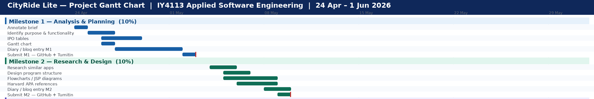

# IY4113 Milestone 2

| Assessment Details | Please Complete All Details |
| ------------------ | --------------------------- |
| Group              | A                           |
| Module Title       | IY4113                      |
| Assessment Type    | Coursework                  |
| Module Tutor Name  | Jonathan Show               |
| Student ID Number  | P466145                     |
| Date of Submission | 08/05/2026                  |
| Word Count         | 1305                        |

- [x] *I confirm that this assignment is my own work. Where I have referred to academic sources, I have provided in-text citations and included the sources in
  the final reference list.*
- [x] *Where I have used AI, I have cited and referenced appropriately.

------------------------------------------------------------------------------------------------------------------------------

### Algorithm Design

------------------------------------------------------------------------------------------------------------------------------

------------------------------------------------------------------------------------------------------------------------------

### Research (minimum of 1 required, preferably 2)

------------------------------------------------------------------------------------------------------------------------------

**Research 1 into Existing Transport Systems (Uber)**

Research into Uber informed the design of CityRide Lite, a
console-based transport application (Uber Technologies Inc., 2024). Key
Uber features journey tracking, fare calculation, peak pricing, discounts, trip
history, and modular software design directly influenced CityRide Lite's
structure (Sommerville, 2016).

Similar features:

- Storing
   journey details (zones, passenger type, date, fare, ID)
- Automated
   zone-based fare calculation with discounts and caps
- Peak
   vs. off-peak pricing based on time bands
- Passenger-specific
   discounts (student, child, senior)
- Journey
   listing, filtering, daily summaries, and totals by passenger type
- Modular
   OOP design (Journey, FareCalculator, JourneyManager, Main) (Oracle, 2024)

Limitations:CityRide Lite is session-only,
console-based, lacks GPS, permanent storage, and real payments. Nevertheless,
Uber provided a valuable real-world reference for organising journeys, pricing
logic, and summaries (Uber Technologies Inc., 2024).

**Research 2  into Existing Transport Systems (Flexibus)**

The development of FlexBus, a console-based bus transport
simulator, was guided by research into existing transport platforms,
particularly Uber (Uber Technologies Inc., 2024). This research helped clarify
how real-world applications handle journey data, fare structures, and user
interaction, even though FlexBus operates on a much smaller scale (Sommerville,
2016).

**Key ideas borrowed from Uber and adapted for FlexBus
include:**

- Storing
   structured journey information: bus route zones, passenger type, travel
   date and time, fare amount, and a unique journey identifier (Uber
   Technologies Inc., 2024)
- Automating
   fare calculations based on the number of zones crossed, with built-in
   discounts and a fare limit (cap)
- Introducing
   peak-time pricing, where travel during busy periods (such as rush hours)
   costs more than off-peak travel
- Offering
   passenger-specific discounts, automatically applied for students,
   children, and senior citizens
- Providing
   journey history features, including the ability to list all trips, filter
   them, view daily summaries, and see total fares broken down by passenger
   type
- Using
   a modular, object-oriented design split across four
   classes:Journey,FareCalculator,JourneyManager,
   and improving code readability and maintainability
   (Oracle, 2024)

**Limitations of FlexBus compared to Uber:**

FlexBus does not use GPS, cannot track live bus positions,
stores no data beyond the current session, processes no real payments, and runs
only in a console environment. Despite these limitations, studying Uber
provided a valuable foundation for designing FlexBus's journey logging, fare
rules, and summary functions (Uber Technologies Inc., 2024; Sommerville, 2016).

-----------------------------------------------------------------------------------------------------------------------------Name of program:
Reference (link):
What it does well (2-3 features that work effectively):
What it does poorly (at least 1 feature):
Key design ideas you could reuse (e.g., layout, navigation, input/output, program structure):
Screenshot (showing the interface/output):

------------------------------------------------------------------------------------------------------------------------------

### Updated Gantt Chart

------------------------------------------------------------------------------------------------------------------------------

### Diary Entries

------------------------------------------------------------------------------------------------------------------------------

Entry 1: Date [04/05/2026] - Research Phase

During this part of the project, I focused on understanding
what the CityRide Lite system needed to do and planning how to build the
application. I read the specification document carefully to find the main
features required, such as adding journeys, calculating fares, applying
discounts, enforcing daily caps, and showing summaries.

I chose to use an object-oriented design because it makes
the program easier to organize and maintain. I started thinking about possible
classes like Journey, FareCalculator, and JourneyManager. Splitting the system
into different classes will help avoid repeating code and make it easier to
read.

I also looked at how real public transport fare systems work
to better understand daily caps and discounted fares. This helped me see the
importance of calculating fares in the right order: first the base fare, then
the discount, and finally the cap adjustment.

One problem I faced was deciding how the daily cap should
work when a fare goes over the limit. After reading the specification a few
more times, I understood that the fare must be reduced so that the total for
the day is exactly the cap, not higher. This planning stage helped me build a
clearer idea of how the final program should work before I start writing the
code.

Entry 2 – Date [05/05/2026]Flowchart and Algorithm Design

I focused on designing the steps and flowcharts for the main
parts of the system. I created flowcharts for the main menu, adding journeys,
removing journeys, filtering journeys, and showing summaries. These diagrams
helped me see how data moves through the application and how user choices
affect the program.

I made sure all flowcharts followed standard rules,
including using diamonds for decisions, rectangles for actions, and ovals for
start and end points. I also made sure each process was logical and easy to
follow.

While designing the "Add Journey" process, I
realized that checking user input is very important. Wrong zone numbers,
passenger types, or time bands could easily cause errors if not handled
properly. To fix this, I added input checks and loops into the design so the
program asks the user again instead of crashing.

Another challenge was designing the filter system, because
the user can search for journeys in different ways. I solved this by creating a
general filtering process where the user first picks a filter type and then
enters the search value.Overall, this design stage helped me better understand
how the application should be built and gave me a strong base for the coding
phase.

Entry 3 – Date [07/05/2026] Research into Java and Data Structures

Today I looked into
Java collections and programming techniques that would help me build the
CityRide Lite system. I decided that ArrayList is the best way to store data
because it can hold journeys during the program run and makes it easy to go
through and filter the data.

I also studied object-oriented programming ideas like
encapsulation and separation of responsibilities. This helped me decide to keep
fare calculations separate from the user interface code. By using different
classes for different jobs, the program will be easier to fix, test, and
improve later.

I read examples from Oracle Java documentation and online
tutorials to better understand how loops, conditions, and methods can create a
menu-driven console application. This research also helped me learn how to
check user input using the Scanner class and exception handling.

One problem I faced was figuring out how to organize methods
without making any class too large. I solved this by giving each class one main
job. For example, the FareCalculator class will only handle fare calculations,
while the JourneyManager class will handle storing journeys and showing
summaries. The research stage made me more confident to start coding because I
now have a better understanding of both the program design and the Java
concepts needed.

------------------------------------------------------------------------

# References

Gamma, E., Helm, R., Johnson, R. and Vlissides, J.
(1994)*Design Patterns: Elements of Reusable Object-Oriented Software*.
Reading, MA: Addison-Wesley.

McConnell, S. (2004)Code Complete: A Practical
Handbook of Software Construction*. 2nd edn. Redmond, WA: Microsoft Press.

Oracle (2024)Java Documentation: Object-oriented
programming concepts*. Available at:[Lesson: Object-Oriented Programming Concepts (The Java&trade; Tutorials &gt; Learning the Java Language)](https://docs.oracle.com/javase/tutorial/java/concepts/) (Accessed:
7 May 2026).

Sommerville, I. (2016)*Software Engineering*.
10th edn. Harlow: Pearson Education.

Uber (2023) 'Dynamic pricing and surge pricing
explained',*Uber Newsroom*, 15 March. Available at:https://www.uber.com/newsroom/dynamic-pricing/ (Accessed:
7 May 2026).

Uber Technologies Inc. (2024)*How Uber works: Rider
guide*. Available at:[https://www.uber.com](https://www.uber.com/)(Accessed:
7 May 2026).
